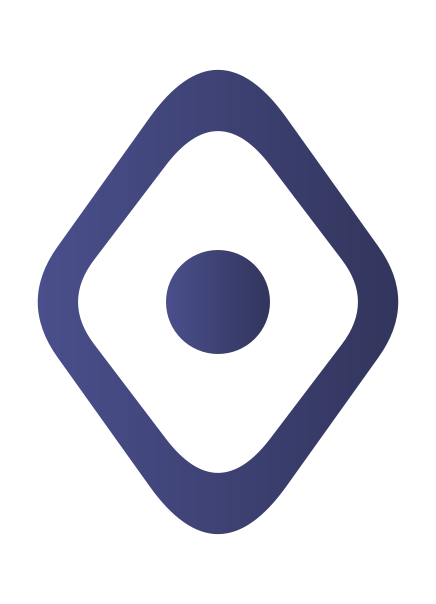
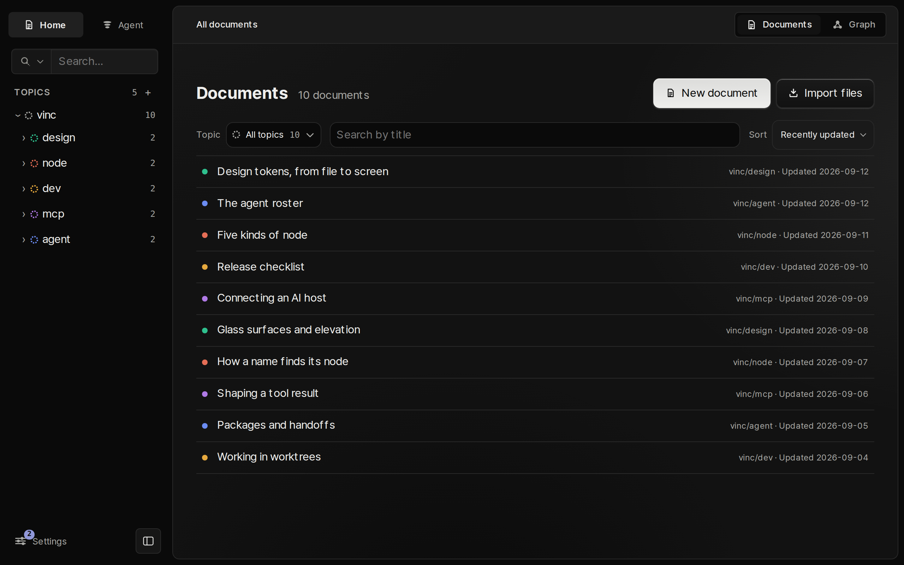
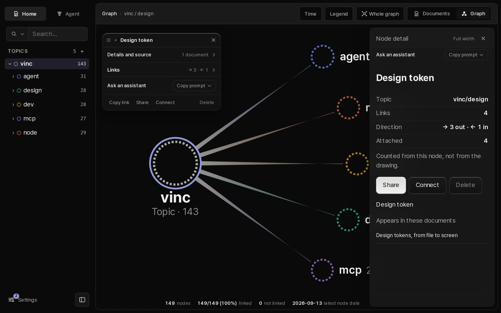
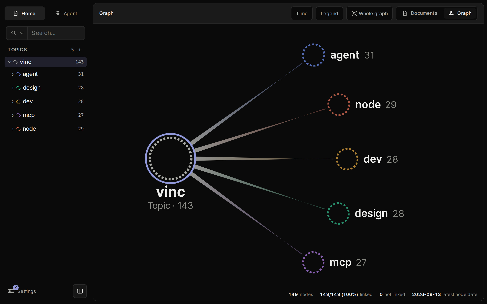
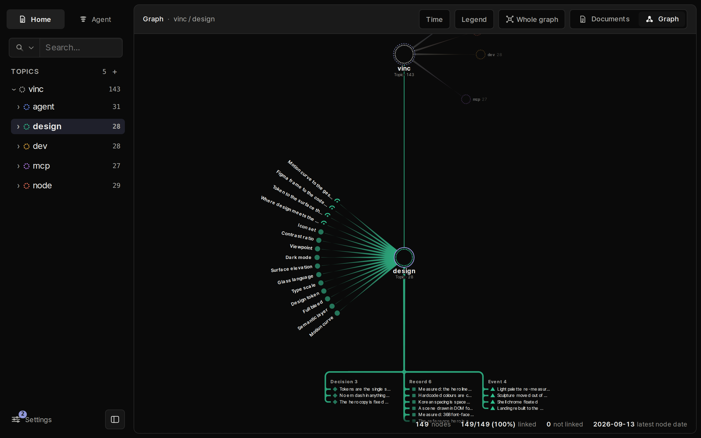
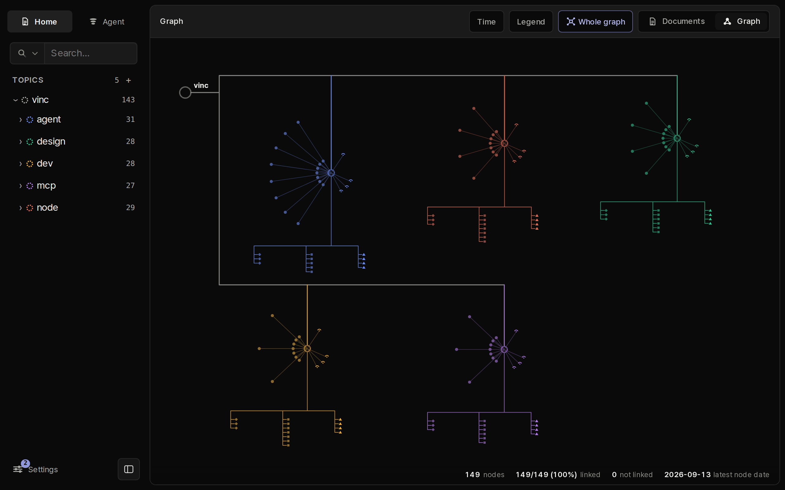
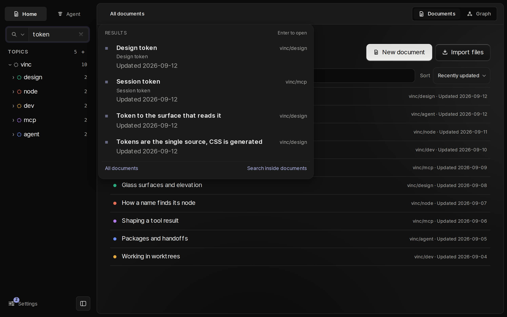
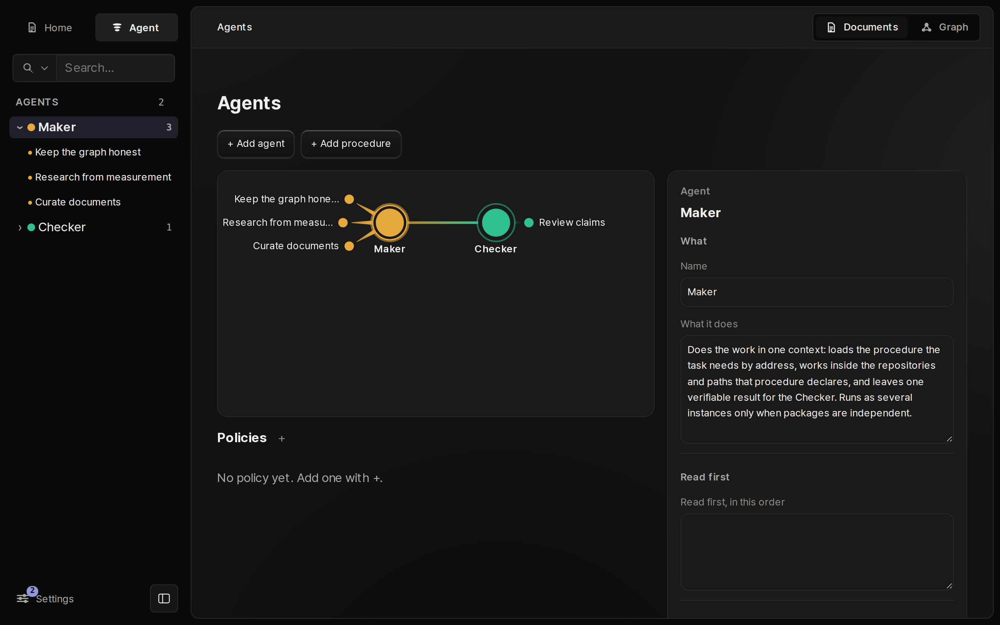
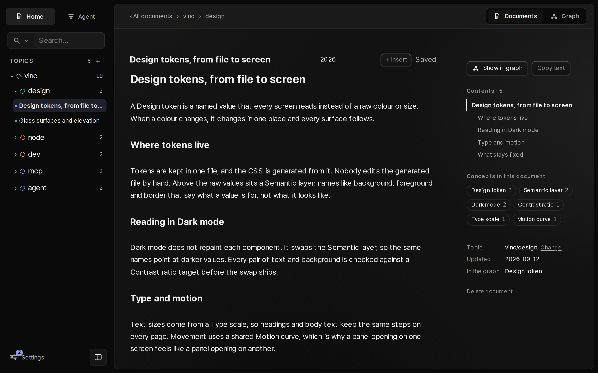

<p align="center">
  <picture>
    <source media="(prefers-color-scheme: dark)" srcset=".github/assets/mark-dark.svg">
    
  </picture>
</p>

<h1 align="center">Vinc</h1>

<p align="center">
  A knowledge graph you share with AI. Connect meaning. Compose Agents.
</p>

<p align="center">
  <a href="https://github.com/Vinculums/Vincs-app/releases/latest"></a>
  <a href="https://github.com/Vinculums/Vincs-app/releases"></a>
  <a href="https://vincs.io/docs/"></a>
  <a href="LICENSE"></a>
</p>

<p align="center">
  <a href="https://vincs.io">Website</a> ·
  <a href="https://vincs.io/demo/">Live demo</a> ·
  <a href="https://vincs.io/docs/">Docs</a> ·
  <a href="https://vincs.io/docs/mcp/">MCP setup</a> ·
  <a href="https://vincs.io/release">Release notes</a>
</p>

Vinc is a knowledge graph you and your AI assistants share. Bring in documents and notes, see how concepts, decisions and records connect on one map, and let the assistants you already use read and write **the same graph** over MCP.

- **One graph on every screen.** Once you sign in, the desktop app shows the graph in your account: the same one the web app shows, and the same one an assistant reaches at `mcp.vincs.io`. There is one copy, so there is nothing to sync.
- **Answers quote your notes; nothing is generated.** Ask answers *What is X* and *Sources for X* with passages from your own documents, and every node lists the documents behind it. You can check each answer against the text it came from.
- **You decide where it lives and what leaves.** The graph lives in your account by default. Local mode keeps it in a folder you pick, with no copy in the account. To share, select part of the graph and send it as a pack: only that part goes.

<p align="center">
  
</p>
<p align="center">
  <em>The document home, the first screen, on the demo graph. Every document, newest first, under one toolbar for topic, title search and sort. Search sits at the top of the sidebar, above the topic tree; Documents and Graph sit at the top right.</em>
</p>

## Get started

**1. Download** for your platform. Each link points at the newest release.

| | | |
|---|---|---|
| **macOS** | Apple silicon, macOS 15 or later | [`Vinc-aarch64.dmg`](https://github.com/Vinculums/Vincs-app/releases/latest/download/Vinc-aarch64.dmg) |
| **Windows** | x64 | [`Vinc-x64-setup.exe`](https://github.com/Vinculums/Vincs-app/releases/latest/download/Vinc-x64-setup.exe) |
| **Linux** | AppImage | [`Vinc-amd64.AppImage`](https://github.com/Vinculums/Vincs-app/releases/latest/download/Vinc-amd64.AppImage) |
| **Linux** | Debian, Ubuntu | [`Vinc-amd64.deb`](https://github.com/Vinculums/Vincs-app/releases/latest/download/Vinc-amd64.deb) |
| **Linux, terminal only** | servers and headless machines | [`Vinc-cli-linux-x86_64.tar.gz`](https://github.com/Vinculums/Vincs-app/releases/latest/download/Vinc-cli-linux-x86_64.tar.gz) |

Fedora and openSUSE use the `.rpm`, and managed Windows installs use the `.msi`. Both are on the [releases page](https://github.com/Vinculums/Vincs-app/releases/latest). The terminal archive holds the `vinc` command alone; sign in with `VINC_API_KEY` as the [CLI docs](https://vincs.io/docs/cli/) describe. Every release lists its assets in `SHA256SUMS`, signed with minisign; the public key is published beside it.

**Check a download.** Put `SHA256SUMS`, `SHA256SUMS.minisig` and `release-signing.pub` from the [releases page](https://github.com/Vinculums/Vincs-app/releases/latest) next to the file you downloaded, then check the signature and the checksum:

```bash
minisign -Vm SHA256SUMS -p release-signing.pub
sha256sum --check --ignore-missing SHA256SUMS
```

`release-signing.pub` is the key the app's updater already trusts. For the terminal archive alone, its own `.sha256` works too: `sha256sum --check Vinc-cli-linux-x86_64.tar.gz.sha256`.

**2. Sign in.** The first screen is the sign-in: **Sign in with email**, or **Continue with Google**. Vinc opens your browser to sign in and approve this device, then shows your documents, newest first. **Graph**, at the top right beside **Documents**, opens the map. While it waits you can cancel, open the page again or copy its address.

**3. Add something.** Drag a document (`.md`, `.txt`, `.rst`, `.pdf`) or a pack (`.vincpack`, `.json`) onto the window, or start from a single note. Or connect an assistant ([Works with](#works-with)) and let it write into the graph.

> **First launch warning.** Vinc is not code-signed yet. On macOS, drag Vinc into Applications and open it; if it is blocked, open System Settings, Privacy & Security, and click **Open Anyway** next to the Vinc message. On Windows, SmartScreen shows "Windows protected your PC": click **More info**, then **Run anyway**. Updates are a separate matter and are signed: the app checks each update's signature before it installs anything.

## See it in action

<p align="center">
  
</p>

Every node can be handed to an assistant as an address. Open a node on the map (here, **Design token** from the demo graph), and in its card choose **Ask an assistant**, **Copy prompt**, **Explain this concept**. You get one line to paste into any assistant connected to Vinc:

```text
Explain this concept using only what is in my Vinc graph. …?space=personal#view/trace/concept%3Adesign-0/d1
```

The assistant passes that address to `vinc_graph` and gets the node back with everything one hop away. Abridged, from the demo graph:

```text
vinc_graph  url="…?space=personal#view/trace/concept%3Adesign-0/d1"

{
  "seed": "concept:design-0", "depth": 1, "found": true,
  "nodes": [
    { "id": "concept:design-0",  "label": "Design token",   "kind": "concept",  "domain": "vinc/design" },
    { "id": "decision:design-0", "label": "Tokens are the single source, CSS is generated", "kind": "decision" },
    { "id": "record:design-0",   "label": "Measured: the hero line is 969.6px at the clamp ceiling", "kind": "record" },
    { "id": "concept:design-1",  "label": "Semantic layer", "kind": "concept" }
  ],
  "edges": [
    { "source": "decision:design-0", "target": "concept:design-0", "type": "ABOUT" },
    { "source": "record:design-0",   "target": "concept:design-0", "type": "ATTACHES_TO" },
    { "source": "concept:design-0",  "target": "concept:design-1", "type": "RELATED_TO" }
  ]
}
```

From there the assistant can walk one hop at a time with `vinc_neighbors`, trace how two concepts connect with `vinc_path`, read a whole document with `vinc_doc_get`, and write new nodes and links back with `vinc_ingest`. The full list of `vinc_` tools is in the [MCP docs](https://vincs.io/docs/mcp/).

## What it does

| Capability | What you get |
|---|---|
| **Documents first** | The first screen is a document home: every document, newest first, read and written in place. One toolbar holds topic, title search and sort, and the topic opens a tree you can search at any level. Documents and the graph share one sidebar: Home and Agent on top, search below them, then the topic tree in topic colours. A topic row narrows the document list or moves the map to that topic. Documents insert tables, math and code blocks, and table cells are edited in place. |
| **The map is a compass** | **Graph** opens one 2D compass at your own top-level topic. The centre is where you are, 12 o'clock is where you came from, 9 is meaning relations, 3 is subtopics and bridges, and 6 is a trunk to the decisions, records and events attached. Click a node to open it where it stands, and click the centre again for its details. Press P to pin a node: it stays in place with its topic chain drawn. **Whole graph** unfolds every topic with every node at once, and **Time** and **Legend** sit beside the Graph title; Time narrows the map to the last 7 or 30 days. |
| **Search and Ask** | Search sits at the top of the sidebar on every screen (Ctrl or Cmd K). It looks up names and keywords (and ranks by meaning on the account graph), and on the map it narrows the compass. **Search inside documents**, under the results, reads the text of your documents and shows the passage that matched. Korean is indexed two characters at a time, so a word is found even with a particle attached. Switch the box to Ask and it answers *What is X* and *Sources for X* by quoting your documents. |
| **Node detail** | For any node: its topic, links out and in, what is attached to it, the documents behind it, and its properties. Edit properties in place as text, list, number, yes or no, or JSON. If the node changed after you started editing, Vinc does not save over it. |
| **Add knowledge** | Drag in `.md`, `.txt`, `.rst` or `.pdf`, or start a new document or node where you are: **New document** and **Import files** on the document home, the tree, the palette, a shortcut or a right-click. Type `[[` to link a node, or choose **Connect** in a node's card to link it to another. Import says where the files go (this device, your account or a team space) and which documents it adds, refreshes or leaves as they are. |
| **Packs** | Choose **Share** on a node and send that part of the graph as a `.vincpack`. The sheet shows what will go and lets you leave items out; one share takes at most 2,000 nodes. Records and decisions travel with it. Import a pack, or double-click one, and it joins your graph. |
| **Agents** | **Agent** in the sidebar opens a map of your agents and their procedures, one colour per agent. Pick a dot to edit it in the side panel, gates included; **Add agent** and **Add procedure** sit under the title, and policies sit in cards under the map. A role says what it outputs, when it may act without asking, its budget and which tools it may use, and its page shows the evaluation cards from its runs. Roles export as skills and files for every assistant host. **Work as this role** copies a prompt that hands the role to an assistant, and an assistant can check its work against the role with `vinc_role_check`. A run that reaches an action only a person may take ends blocked and names the action, so your assistant reports it to you. |
| **Spaces** | The current space shows in the view header, and you switch between your personal graph and a team's shared graph from there. Settings, Spaces lists the spaces you work in. Every screen follows the space you pick. |
| **MCP, CLI and API** | Web assistants reach the graph in your account at `https://mcp.vincs.io/mcp`. Settings, Web assistants shows it with a **Copy address** button. An assistant on this computer sees what the app shows: the account graph in account mode, this computer's graph in local mode. The `vinc` command, REST v1 and Python packages for LangGraph and Microsoft Agent Framework reach the same graph ([CLI](https://vincs.io/docs/cli/), [API](https://vincs.io/docs/api/), [Frameworks](https://vincs.io/docs/frameworks/)). |
| **Storage and local mode** | Settings, Storage shows where your graph lives. **Keep it on this device** puts the graph in a folder you pick, and your account holds no copy. Storage can also check and connect a Neo4j database of your own; `vinc storage status`, `connect` and `move` do the same from the CLI. |
| **Updates** | The app checks for a new release and offers to install it. The update's signature is checked before anything is installed. |

<table>
  <tr>
    <td width="50%"></td>
    <td width="50%"></td>
  </tr>
  <tr>
    <td><em>The map opens at your top-level topic. The centre is where you are, and the subtopics sit at 3 o'clock.</em></td>
    <td><em>One topic in the centre: where you came from at 12, its concepts at 9, and a trunk at 6 to the decisions, records and events attached.</em></td>
  </tr>
  <tr>
    <td></td>
    <td></td>
  </tr>
  <tr>
    <td><em>Whole graph: every topic with every node at once. Press it again to return to the layer you were in.</em></td>
    <td><em>Search: type <code>token</code> at the top of the sidebar and the matching nodes come back with their topic. <strong>Search inside documents</strong> reads the text of your documents.</em></td>
  </tr>
  <tr>
    <td></td>
    <td></td>
  </tr>
  <tr>
    <td><em>Agent: a map of Maker, Checker and their procedures, one colour per agent. Pick a dot to edit it in the side panel; policies sit under the map.</em></td>
    <td><em>A document opens in place, with its contents, the concepts in it, its topic and the node it became beside it. <strong>Insert</strong> adds tables, math and code, and <strong>Show in graph</strong> jumps to the node.</em></td>
  </tr>
</table>

## Works with

Assistants connect to the graph in your account through one address: `https://mcp.vincs.io/mcp`. A team's shared graph has its own address, `https://mcp.vincs.io/t/<team-id>/mcp`, shown on the team page. Each host signs in to your Vinc account the first time.

| Host | How to add Vinc |
|---|---|
| **ChatGPT** | Add a custom connector with the address (ChatGPT keeps custom connectors behind developer mode). |
| **claude.ai** | Customize, Connectors, Add custom connector, then paste the address. Claude Desktop, signed in, uses the same connectors. |
| **Claude Code** | `claude mcp add --scope user --transport http vinc https://mcp.vincs.io/mcp`, then run `/mcp` in a session, choose vinc and authenticate. |
| **Codex CLI** | `codex mcp add vinc --url https://mcp.vincs.io/mcp`, then `codex mcp login vinc`. |
| **Cursor, Zed, Windsurf, Copilot and others** | Point the host's MCP configuration file at the address. |

Step by step, per host: [vincs.io/docs/mcp](https://vincs.io/docs/mcp/).

## Your data

- **By default the graph lives in your account.** The desktop app sends each read and write to your account through its local engine. The key for this device is kept in the system keychain; where there is no keychain, it is kept in the app's own folder, where anything running as your user can read it.
- **Local mode keeps it on this device.** The graph lives in a folder you pick and your account holds no copy. You still sign in. Vinc warns you if the folder is synced by a cloud drive or sits on a network drive, because a copy taken while Vinc is writing can break the graph.
- **What was already on this device stays there.** If this device holds a graph from an earlier version, Vinc keeps opening it from this device. Turning local mode off offers two ways: **Move to my account and turn off** moves every topic on the device to your account, after you confirm, and **Switch without moving** shows your account graph and leaves this device's graph in its folder, untouched. Either way the folder stays as it is.
- **Sharing is a pack you choose.** A pack carries only the part of the graph you selected.
- The app ships no analytics or tracking library. It contacts GitHub Releases to check for updates.

## Troubleshooting

**macOS or Windows will not open the app.** Vinc is not code-signed yet. Follow the steps under [Get started](#get-started), or the [download page](https://vincs.io/download).

**Search or saving pauses right after an update.** The first launch after an update can rebuild the search index. A line at the top says so; it takes a minute or two, and it goes away when the index is ready.

**The screens are empty after sign-in.** If a line at the top says Vinc can't reach your account, the graph is in the account and the screens stay empty until the connection is back: press **Try again**. On a new account the graph is simply empty: add a file.

**Does it work offline?** The first sign-in needs a network. In the default account mode the app needs to reach your account. Local mode reads the graph from a folder on this device.

**A graph I made before signing in is not on the web.** It stayed on this device. To move it into your account, turn off local mode in Settings, Storage, and choose **Move to my account and turn off**. Vinc asks before it moves anything.

**A large file will not import.** In account mode a single import has a size limit, and a PDF reaches it sooner than text. Vinc says so when a file is over it: split the file.

**An assistant cannot open a node address.** Check that the assistant is signed in to the same Vinc account, and that the `space` in the address is one you can reach.

## This repository

It hosts the published installers and nothing else. The application source is maintained privately; what ships here is the build.

The installers are licensed under the Functional Source License (FSL-1.1-ALv2), in [LICENSE](LICENSE): you may use, modify and run Vinc for any purpose except offering it to others as a competing commercial product or service, and each version is also licensed under Apache-2.0 two years after its release. Releases published before 29 October 2026 were distributed under the MIT License and stay under it. The integration packages on PyPI are Apache-2.0. Details: [vincs.io/licensing](https://vincs.io/licensing/).

- Report something broken or unsafe: [support@vincs.io](mailto:support@vincs.io) or [vincs.io/support](https://vincs.io/support)
- What changed in each version: [vincs.io/release](https://vincs.io/release)

<p align="center">
  <sub>© 2026 Vinc · <a href="https://vincs.io/licensing/">Licensing</a> · <a href="https://vincs.io/privacy">Privacy</a> · <a href="https://vincs.io/terms">Terms</a></sub>
</p>
